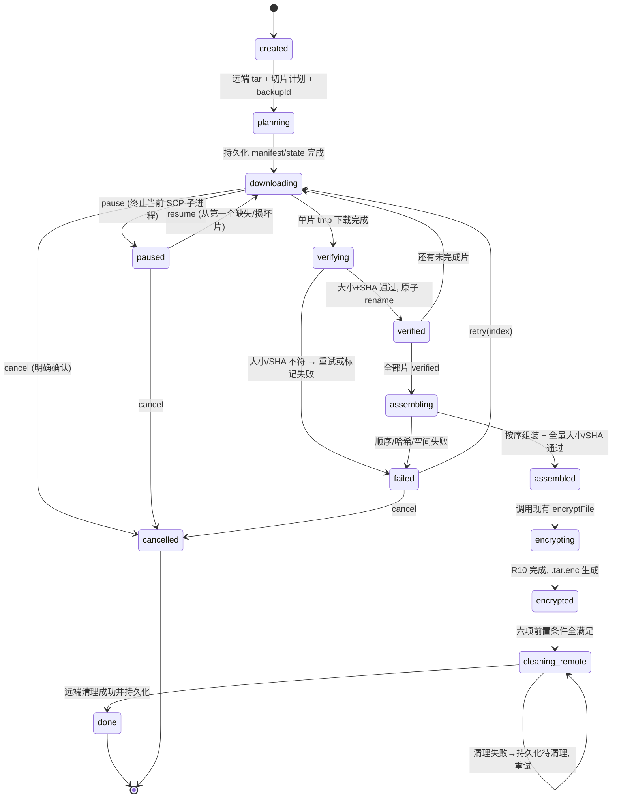

# DSH-Odoo19-Backup v0.1.13 Design Spec — SCP 大文件分片、断点续传与完整组装

> **状态**：设计规格（待用户审核批准）
> **日期**：2026-11-07
> **基线**：v0.1.12（Git commit `a0f715d`，GitHub Release `v0.1.12`，全套 293/293）
> **分类**：Architectural（新增持久化任务状态机 + 分片调度子系统，与现有备份流程在传输边界交叉）
> **本轮约束**：只更新设计规格；**禁止编写任何代码、禁止创建实现计划、禁止 TDD、禁止修改源代码**。完成后 STOP 等待批准。
> **验收纪律**：完成前不得宣称断点续传已通过验收。

---

## 1. 目标、非目标与版本范围

### 1.1 目标
- 对 ≥100 MiB 的远端备份 tar，实施 **远端切片 → SCP 分片下载 → 单片 SHA-256 校验 → 断点续传 → 本地组装 → 全量校验 → 现有 R10 加密**。
- 任务状态、Manifest、分片与临时组装文件**持久化到 Host 本地磁盘**，支持页面刷新 / DSH 重启后恢复。
- 暂停 / 继续 / 重试 / 取消为**真实控制**（终止 SCP 子进程、清理、重新调度），不是只加路由。
- 新增 `backupDirectory` 配置与目录验证 UI。
- **补齐前端真实进度条**：备份与恢复都要有可视进度条（百分比 + 阶段文案 + 分片明细），数据来自 Host 持久化任务状态，不得只用静态文字。
- **P0 服务器级互斥**：同一服务器同一时间只允许一个备份或恢复任务；后端锁为唯一裁决，前端禁用仅为辅助（§17.1）。

### 1.1.1 进度条缺失的根因（2026-11-07 真机反馈，已核查）
v0.1.12 只在**后端**加入了进度计算（`runBackup` 的 9 个 `onProgress` 阶段、`scpDownload` 的 `computeTransferPercent` 文件轮询）与 `service.status()` 透出；**前端从未渲染进度条，也没有轮询 `/status`**。`client.js` 中只有 `h(Status, { text: status[s.name] })` 静态文本，按钮回调只设 `'backing up...'` 然后 await 结果。因此用户看到的是一行文字而非进度条。
- **后端已有**：`lib/backup.js:259,304,326,358,374,385,405,420,428`（phase/percent/message）、`lib/service.js:96-100`（progressReporter 写入 `task.phase`）、`index.js /status` 返回 `lastTask.phase`。
- **前端缺失**：`client.js` 无 `percent`、无进度条元素、无 `/status` 轮询；恢复侧同样只有 `h(Status,{text})`。
- **本版要做的是「把已有后端数据渲染成真实进度条」**，不是重做进度计算；进度数据源统一为 §6 的 `transfer-state.json`（备份）与恢复任务状态（见 §14.3），避免两套机制。

### 1.2 非目标
- 不扩展到「恢复服务器上传」的分片（本轮只处理备份下载方向）。
- 不重构无关模块、不重新调查 v0.1.12 已解决问题（alias 支持、文件轮询进度、OpenSSH `%` 条不可用）。
- 不引入密码认证、不使用 `accept-new`、不重写 SSH/SCP。
- 不把进度显示成功当作断点续传成功；不把 SHA-256 描述成来源认证；不把内存任务状态描述成持久化任务。
- 不引入独立存储管理子系统、不引入额外数字签名系统。

### 1.3 版本范围
- 目标版本 `0.1.13`；基线 `0.1.12`。
- 不改现有备份格式、压缩算法、R10 加密、SSH 安全机制、恢复核心与恢复入口。

---

## 2. 当前备份流程与新流程对照

### 2.1 当前流程（v0.1.12，源码依据 `lib/backup.js`）
```
[远端] buildDumpScript → dump.zip/addons/pydeps/odoo.conf/MANIFEST.json
      → tar -cf /tmp/odoo-backup-<ts>.tar  (远端明文 tar)
      → stat -c %s (outerSize) + sha256sum (outerSha)
[传输] scpDownload(server, outer, localTar, 7200000, onProgress, outerSize)
      → buildScpArgs(server,{direction:'download',remotePath,localPath})   ← 单文件 SCP
      → 本地文件大小轮询 / outerSize 算进度（transferring 60–80%）
      → stat 校验本地大小 == outerSize
[本地] encryptFile(localTar, localTar.enc, passphrase)  ← R10（此时才产生 .tar.enc）
      → rm 明文 tar
      → 远端 rm -rf workDir + outer
      → 返回 { ok, localPath: ...tar.enc, bytes, sha256Remote, encrypted, format, manifest }
```
关键点：**远端只有明文 `.tar`；`.tar.enc` 是本地加密之后才有的**。恢复入口 `runRestore({packagePath})` 只认一个完整 `.tar.enc` 文件路径。

### 2.2 新流程（v0.1.13，方案 A 已批准）
```
[远端] 与 2.1 完全相同：生成完整明文 tar、outerSize、outerSha、原 MANIFEST.json（备份元数据）
      + 新增：远端按 100 MiB 切出 part001..partN 与其 SHA-256（远端切片，不加密）
[传输] outerSize < 100 MiB → 走 2.1 原单文件 SCP 路径（零改动）
      outerSize ≥ 100 MiB → 分片路径：
        为每片调用 buildScpArgs(server,{direction:'download',remotePath:分片路径,localPath:partNNN.tmp})
        单片：下载→大小校验→SHA-256→原子 rename 为 partNNN→持久化 transfer-state
        断点：重新 stat + SHA 重验每片，只重下缺失/损坏片
[本地] 全部片校验通过 → 按序组装回完整明文 tar → 全量大小 + SHA-256 == outerSha
      → 调用现有 encryptFile(tar, tar.enc, passphrase)  ← 加密时机/算法/格式不变
      → rm 明文 tar 与分片（成功后）
      → 远端清理（见 §13）
      → 返回与 2.1 完全相同结构的结果（最终产物仍是 .tar.enc）
```
**顺序不变**：远端明文 tar → 传输 → 本地组装 → 本地加密 → `.tar.enc`。不得把加密提前到远端。

---

## 3. 本地备份目录设置与兼容策略

### 3.1 新配置
- 字段：`backupDirectory`，字符串，默认 `K:\\Backup\\odoo`（与现行 `localBackupDir` 默认值一致）。
- 与现有 `localBackupDir`（`index.js:49`）的关系：**`backupDirectory` 为唯一权威目录**；`localBackupDir` 保留但仅作为兼容读取（若 `backupDirectory` 未设置则取其值），不再作为写入依据。此决策写入规格，**实现时不得同时维护两套写入路径**。
- `runBackup({ localDir })`（`backup.js:233,237`）继续接收 `localDir`，由 `service.backup()` 从 `backupDirectory` 解析后传入；大文件与小文件共用同一配置。

### 3.2 设置界面要求
- 显示当前本地备份目录；可修改。
- 验证：目录是否存在、是否可写（以真实 `mkdir` + 探测写 + `stat` 为准，不只看字符串）。
- 不存在时按规则创建（递归 `mkdir`，沿用 `backup.js:379` 的 `mkdir(dateDir,{recursive:true})` 风格）。
- 显示目录验证结果、显示当前备份实际完整路径。

### 3.3 目录规则（已批准，逐条落实）
1. 修改目录只影响**新建任务**。
2. 不自动迁移旧备份。
3. 未完成任务绑定**创建时的原目录**（写入 `transfer-state.json` 的 `backupDirectory` 字段）。
4. 旧任务恢复时必须使用任务记录中的目录，**不是**当前配置。
5. 目录不可用 → **fail-closed**，不静默退回其他路径。
6. 小文件与大文件共用同一配置。
7. 分片、Manifest、任务状态、临时组装文件统一归属于该根目录。
8. 清理旧备份时**不能删除未完成任务**（清理逻辑须先读任务状态）。

---

## 4. 目录结构

```
<backupDirectory>/<YYYYMMDD>/<backupId>/
├── manifest.json              # 分片清单（Host 生成，见 §5）
├── transfer-state.json        # 持久化任务状态（见 §6）
├── part001                    # 已校验正式分片（原子 rename 后）
├── part002
├── partNNN
├── partNNN.tmp                # 下载中的临时分片（未校验通过前不得当有效片）
├── assembling.tar.tmp         # 组装中的完整明文 tar（临时）
├── odoo-backup-<ts>.tar       # 组装完成、校验通过（短暂存在）
└── odoo-backup-<ts>.tar.enc   # 最终产物（按现有存储规则，避免重复保存）
```
- `<YYYYMMDD>` 沿用 `backup.js:365-378` 的 `dateDir` 规则（任务创建时确定）。
- `<backupId>` 见 §5；小文件路径仍用现行 `dateDir/odoo-backup-<ts>.tar.enc`，**不建 backupId 子目录**（兼容旧备份）。
- 最终 `.tar.enc` 只保留一份；明文 tar 与分片在加密成功后删除。

---

## 5. Manifest 数据结构

### 5.1 backupId（绑定与信任边界）
```
backupId = sha256( serverConfigId + remoteTarPath + totalBytes + fullSha256 + createdAt + randomSalt )
```
- `serverConfigId` = 服务器配置标识（`name` / `host` / `port` / `user` / `sshConfigAlias` 的稳定摘要，不含私钥）。
- `remoteTarPath` = `/tmp/odoo-backup-<ts>.tar`。
- `fullSha256` = 远端 `sha256sum` 得到的 `outerSha`（`backup.js:362`）。
- `randomSalt` 由 Host 本地生成，防止同秒同服务器碰撞。
- **信任边界**：Manifest 由 Host 根据「现有 SSH 信任通道」获取的信息生成，保存在本机 Host 磁盘；恢复时重新核对 Manifest、状态文件与实际分片；**不引入额外数字签名系统**。
- **明确声明**：SHA-256 只验证**数据完整性**，**不证明 Manifest 来源真实性**（规格与将来 UI 文案均不得混淆）。

### 5.2 manifest.json（结构及一致性校验）
```json
{
  "schemaVersion": 1,
  "backupId": "<sha256 hex>",
  "createdAt": "<ISO8601>",
  "serverConfigId": "<sha256 hex>",
  "remoteTarPath": "/tmp/odoo-backup-<ts>.tar",
  "remoteWorkDir": "/tmp/odoo-backup-<ts>",
  "fileName": "odoo-backup-<ts>.tar",
  "totalBytes": 590000000,
  "fullSha256": "<outerSha hex>",
  "chunkSize": 104857600,
  "chunkCount": 6,
  "chunks": [
    { "index": 1, "offset": 0, "size": 104857600, "sha256": "<hex>", "remotePart": "/tmp/odoo-backup-<ts>.tar.part001" },
    { "index": 2, "offset": 104857600, "size": 104857600, "sha256": "<hex>", "remotePart": "..." }
  ],
  "source": "host-generated-over-existing-ssh-trust"
}
```
- 结构校验：`schemaVersion===1`、`chunkCount===chunks.length`、序号连续从 1、偏移量累加等于 `totalBytes`、每片 `size>0` 且 `sha256` 为 64 hex、`backupId` 可由 §5.1 重算比对。
- Manifest 与 `transfer-state.json` 的 `backupId` / `totalBytes` / `fullSha256` / `chunkCount` 必须一致，否则**拒绝组装**。

---

## 6. 持久化任务状态结构

`transfer-state.json`（**唯一持久化状态来源**，见 §6.3）：
```json
{
  "schemaVersion": 2,
  "taskId": "<uuid/v4 或 sha256(backupId+kind+createdAt)>",
  "backupId": "<sha256 hex>",
  "kind": "backup | restore",
  "status": "running",
  "phase": "downloading",
  "percent": 63,
  "phaseMessage": "正在下载备份单元 13%",
  "backupDirectory": "K:\\Backup\\odoo",
  "taskDir": "K:\\Backup\\odoo\\20261107\\<backupId>",
  "serverConfigId": "<sha256 hex>",
  "remoteTarPath": "/tmp/odoo-backup-<ts>.tar",
  "remoteWorkDir": "/tmp/odoo-backup-<ts>",
  "totalBytes": 590000000,
  "fullSha256": "<outerSha hex>",
  "chunkSize": 104857600,
  "chunkCount": 6,
  "createdAt": "<ISO8601>",
  "updatedAt": "<ISO8601>",
  "concurrency": 1,
  "activeExecutor": null,
  "chunks": [
    { "index": 1, "status": "verified", "localPath": ".../part001", "bytes": 104857600, "attempts": 1, "lastError": null },
    { "index": 2, "status": "pending",  "localPath": null,            "bytes": 0,        "attempts": 0, "lastError": null }
  ],
  "downloadedBytes": 104857600,
  "speedBytesPerSec": 0,
  "etaSeconds": null,
  "remoteCleanup": { "status": "pending", "attempts": 0, "lastError": null },
  "finalEncPath": null,
  "integrity": { "assembled": false, "fullSha256Ok": false, "encrypted": false, "finalEncVerified": false }
}
```
- 每片 `status` ∈ `pending | downloading | verifying | verified | failed | missing`。
- **禁止仅凭 `status==='verified'` 跳过实际文件校验**（恢复时必须重新 stat + SHA，见 §10）。
- 结构及一致性校验：与 Manifest 的 `backupId/totalBytes/fullSha256/chunkCount` 一致；`chunks.length===chunkCount`；每片 `index/offset` 与 Manifest 对齐；`backupDirectory` 为绝对路径。
- `activeExecutor` 用于并发控制（§17）：非 `null` 时表示有活动执行者，重启恢复时先清空再接管。

### 6.1 任务生命周期（status，六态）
`status` 为**任务级生命周期**，取值固定为：

| 状态 | 含义 | 进入条件 |
|---|---|---|
| `pending` | 已创建、尚未开始执行 | 任务创建并持久化后 |
| `running` | 正在执行 | 调度器开始工作（下载/组装/加密/清理/恢复） |
| `paused` | 用户暂停，子进程已终止 | `pause` 真实终止 SCP 后（§9） |
| `completed` | **仅后端确认成功后**才可置位 | 见下方硬约束 |
| `failed` | 不可恢复错误 | 结构校验失败/全量 SHA 失败/磁盘不足等（§15） |
| `cancelled` | 用户明确确认取消 | `cancel(confirm:true)`（§9） |

**completed 硬约束（用户要求）**：
- `status='completed'` **只能由后端在以下条件全部满足后写入**：备份侧 = §13 六项全满足 + 最终 `.tar.enc` 验证成功 + 远端清理状态 `done`；恢复侧 = 现有 `runRestore` 状态机成功提交。
- 前端**不得**凭轮询到 100% 或界面动画自行显示 `completed`；进度条到 100% 与 `status='completed'` 是两件事。
- 只有 `transfer-state.json` 中 `status='completed'` 才是最终成功；**刷新页面后 UI 从该文件读取并正确恢复最终状态**（completed/failed/cancelled 均持久化，不回退成 0% 或「进行中」）。
- `failed` / `cancelled` 同样持久化，刷新后显示对应终态与诊断信息，不重新进入 `running`。

`phase`（`planning/downloading/assembling/encrypting/cleaning-remote/…`）是**阶段**，与 `status` 正交：`running` 可处于任一 phase；`paused` 保留进入暂停时的 phase 与 percent；终态保留最后 phase。

### 6.2 任务隔离（taskId 唯一性）
- **`taskId` 全局唯一**：`taskId = sha256(backupId + kind + createdAt + randomSalt)`；同一 `backupId` 的备份任务与恢复任务因 `kind` 不同而 taskId 不同。
- 状态记录**必须包含** `taskId`、`kind`、`status`、`phase`、`percent`、`updatedAt`（以及 §6 其余字段）。
- **防止旧任务覆盖新任务**：所有状态写入采用「读当前 `taskId` → 比对本次执行者持有的 `taskId` → 不一致则拒绝写入」的乐观校验；`/status` 与 `/chunk-status` 返回当前活动 `taskId`，前端轮询按 `taskId` 归属渲染，旧响应（携带旧 taskId）到达时丢弃。
- **防止备份和恢复进度混淆**：`kind` 字段强制区分；备份进度条只消费 `kind==='backup'` 的状态，恢复进度条只消费 `kind==='restore'` 的状态；同一时刻若两者并存，Host 分别维护各自 `transfer-state.json`（恢复任务文件位于同一 `backupDirectory` 下、以 taskId 命名，见 §14.3「不增加第二套持久化机制」）。
- 任务创建时即固定 `taskId` 并持久化；重启恢复沿用原 `taskId`，不重新生成。

### 6.3 统一状态来源（单一数据源，无双写矛盾）
- **`transfer-state.json` 是唯一持久化状态来源**。`/status`、`/chunk-status`、暂停/继续/重试/取消、进度条渲染**全部从它读取**，不得形成「内存任务状态」与「持久化状态」互相矛盾的双数据源。
- `/status` 读取契约（用户要求明确）：
  1. 定位当前活动任务：优先读取 Host 进程内登记的 `activeTaskId`（仅作指针，**不是状态副本**）；若为空（重启后）则扫描 `<backupDirectory>/<YYYYMMDD>/*/transfer-state.json` 与恢复任务状态文件，取 `updatedAt` 最新且非终态者；
  2. 读取该 `transfer-state.json`，做结构及一致性校验（§5/§6）；
  3. 返回 `{ ok, taskId, kind, status, phase, percent, phaseMessage, updatedAt, … }`——**字段值与磁盘文件逐字段一致**，不叠加内存推算值；
  4. `phase`/`percent` 的更新由后端 `progressReporter` 在写内存 `task` 的同时**原子写回 `transfer-state.json`**（写 `.tmp`+`rename`），保证内存与磁盘同源；`progressReporter` 不再作为独立真相源。
- **优先复用现有后端实现，只补充必要字段**：现有 `service.js:96-100` 的 `progressReporter`（写 `task.phase`）、`service.js:210-224` 的 `status()`（读 `task`）、`backup.js` 的 9 个 `onProgress` 阶段、`runRestore` 的 `onProgress` **全部保留**；只在其上补充：写回 `transfer-state.json`、`taskId/kind/status/percent/updatedAt` 字段、`/status` 改为以磁盘为准。**不重写后端进度计算、不重写 SCP 传输机制**。
- 明确：`service.js` 里 `let task = null` 降级为「当前活动任务的内存指针/缓存」，**刷新或重启后以磁盘为准重建**；任何返回给前端的状态都以 `transfer-state.json` 为准。
- **服务器级互斥锁（§17.1）是统一状态源的一部分**：`server-lock.json` 只记录 `{serverConfigId, taskId, kind, status, acquiredAt}` 指针，不复制任务进度/状态；锁的判定始终回查对应 `transfer-state.json`，**不构成第二套状态数据源**。

---

## 7. 任务状态机与状态转换图

### 7.1 状态
```
created → planning → downloading ⇄ paused
                     ↓ (单片完成)        ↑ resume
                  verifying → verified / failed
                     ↓ (全部片 verified)
                  assembling → assembled
                     ↓ (全量 SHA 通过)
                  encrypting → encrypted
                     ↓ (最终 .tar.enc 验证)
                  cleaning-remote → done
任意态 → cancelled (显式确认) / failed (不可恢复错误, 保留诊断)
```

### 7.2 状态转换图（Mermaid）


### 7.3 转换守卫
- `pending → running` 守卫：**先通过 §17.1 服务器级互斥锁**（原子获取成功），否则保持 `pending` 并拒绝启动；任何 kind、任何入口均不绕过。
- `downloading → assembling` 守卫：**所有片** `verified` 且恢复时重校验通过。
- `encrypted → cleaning-remote` 守卫（§13 六项）全部为真。
- `cancelled` 需用户明确确认；取消后清理本地临时数据（`.tmp` / `assembling.tar.tmp`），**保留已校验正式分片**以便诊断，但任务不再自动续传（如需重来则新建任务）。
- `failed` 不自动删除远端数据（§13）。

---

## 8. SCP 分片下载调用链

```
POST /odoo-backup/backup 或 POST /odoo-backup/restore
  → 统一互斥检查（§17.1）：原子获取 serverConfigId 锁，失败即拒绝
  → service.backup(name) / service.restore(...)               [service.js:110/146]
      → requireTrusted(name)                                  [service.js:86]  ← 不变
      → requirePassphrase()                                   [service.js:43]  ← 不变（Credentials）
      → d.discover(server)
      → d.runBackup({ server, instance, localDir, passphrase, onProgress })
           → 远端生成 tar + outerSize + outerSha              [backup.js:359-369] ← 不变
           → 若 outerSize >= 100 MiB：
               chunkTransfer.ensurePlan(server, outer, outerSize, outerSha, backupDirectory)
                  → 远端 execRemote 切片（dd/split，参数为固定路径，stdin 传参，防注入）
                  → 远端逐片 sha256sum → Host 生成 manifest.json + transfer-state.json
               chunkTransfer.run({ server, manifest, state, onProgress })
                  循环每片（并发=1）：
                     buildScpArgs(server, {direction:'download',
                                           remotePath: chunk.remotePart,
                                           localPath: <taskDir>/partNNN.tmp})   ← 复用，alias 安全
                     spawn('scp', args) → 子类进程句柄登记（供 pause/cancel 终止）
                     下载完成 → stat(size) → sha256(buf) → 比对 manifest.chunks[i].sha256
                        通过 → fs.rename(tmp, partNNN) 原子落盘 → 持久化 state
                        失败 → 删除 tmp, attempts++, lastError, status=failed（不标记完成）
                  全部 verified → assemble → encryptFile → 远端清理
           → 若 < 100 MiB：走现有 scpDownload 单文件路径（零改动）
  → 任务终态（completed/failed/cancelled）→ 原子释放服务器锁（校验 taskId）
```
- **每片必须复用 `buildScpArgs`**（`lib/ssh.js:40`），显式 host 与纯 `sshConfigAlias` 均适用；安全参数 `BatchMode=yes` / `StrictHostKeyChecking=yes` 不变。
- Host Key Verification 与 `guardHostKey` fail-closed 在 `requireTrusted` 处完成一次，分片下载不绕过。
- 远端切片脚本经 `execRemote`（`lib/ssh.js:149`，base64 脚本 + stdin 参数）执行，不拼 shell 字符串。

---

## 9. 暂停、继续、重试、取消的真实行为

| 操作 | 真实行为 |
|---|---|
| **暂停** | 设置 `state.phase='paused'` 并持久化；**终止当前 SCP 子进程**（登记的子进程句柄 → `SIGTERM`，超时 `SIGKILL`）；删除当前未完成 `.tmp`；已 `verified` 片保留；不终止远端数据。 |
| **继续** | 重新读取磁盘 state → 逐片 stat+SHA 重验 → 从**第一个缺失/损坏/失败**片开始重新调度；沿用原 backupId 与原目录。 |
| **重试** | `POST /chunk-retry { backupId, index }`：仅把指定片置回 `pending`、清 `lastError`，重新调度该片；其余片不动。 |
| **取消** | 需明确确认参数（`confirm:true`）；终止子进程、清理 `.tmp` / `assembling.tar.tmp`、置 `phase='cancelled'` 并持久化；**不清理远端**（远端数据保留，供人工/后续任务诊断）；不删除已校验正式分片。 |
| **重启恢复** | 见 §10。 |

- 必须设计 **SCP 子进程登记/终止/清理**：`chunk-transfer.js` 维护 `Map<backupId, ChildProcess>`，pause/cancel 时按 backupId 取句柄终止。
- 「同一个 backupId 同一时刻只能有一个活动传输执行者」（§17）。

---

## 10. DSH 重启后的恢复流程

1. 启动/页面刷新后，UI 调 `GET /chunk-status`；Host 扫描 `<backupDirectory>/<YYYYMMDD>/*/transfer-state.json`。
2. 对每个未完成态（`downloading/paused/failed/assembling/encrypting/cleaning-remote`）任务：
   - 校验 `transfer-state.json` 与 `manifest.json` 结构及一致性（§5/§6）。
   - **用任务记录中的 `backupDirectory`**，不用当前配置。
   - 清理 `activeExecutor`（重启后旧句柄必然失效）。
   - **逐片重新检查**：文件存在、大小正确、SHA-256 匹配、属于当前 backupId；`verified` 状态只是提示，**必须实际重验**。
   - 已通过 → 跳过；缺失/损坏 → 置 `pending` 重新下载。
3. 若 `phase==='assembling'` 但 `assembling.tar.tmp` 存在：删除临时组装文件，从分片重新组装（不信任半成品）。
4. 若 `phase==='encrypting'` / `cleaning-remote`：按 §13 六项条件重新判定，不得假装已完成。
5. `remoteCleanup.status==='failed'` 时持久化待清理状态，重试清理，不标记 done。
6. 恢复后从 `downloading` 继续；用户也可主动 pause/resume/cancel。

---

## 11. 分片校验与完整文件校验

### 11.1 单片
- 下载到 `partNNN.tmp` → `stat(size) === manifest.chunks[i].size` → 计算 SHA-256 → 与 `manifest.chunks[i].sha256` 比对 → **全部通过才 `rename` 为 `partNNN`**。
- 校验失败或传输中断：**不得标记完成**；删除 `.tmp`；`attempts++`、`lastError`、`status=failed`；可重试。
- 未完成 `.tmp` 永不当有效分片（§10 重验时忽略 `.tmp`）。

### 11.2 完整文件
- 组装前：片数/序号/偏移/大小逐片与 Manifest 对齐；**分片顺序错误 → 拒绝组装**。
- 组装后：`stat(totalBytes) === manifest.totalBytes` 且 `sha256(assembled) === manifest.fullSha256`。
- **完整 SHA-256 不一致 → 禁止进入恢复流程**，保留诊断信息，不标记「可恢复备份」。
- Manifest 与 backupId 不匹配 → 拒绝组装（§5.1 重算比对）。

---

## 12. 本地组装与 R10 加密衔接

- 组装：按 `index` 升序读 `partNNN` → 追加写 `assembling.tar.tmp` → 全量校验通过 → `rename` 为 `odoo-backup-<ts>.tar`。
- **调用现有 `encryptFile(tar, tar.enc, passphrase)`**（`lib/crypto.js:93`）：算法、格式、时机与 v0.1.12 完全一致；口令来自现有 Credentials（`requirePassphrase`，不缓存）。
- `isEncrypted(encPath)` + `detectFormat(encPath)` 校验（沿用 `backup.js:409-412`）。
- 成功后删除明文 tar 与分片（按 §4「避免重复保存」）；**最终产物仍是单个 `.tar.enc`**，恢复入口零改动。
- 失败：保留 `assembling.tar.tmp` 与分片供诊断，`integrity.fullSha256Ok=false`，不产出 `.tar.enc`。

---

## 13. 远端文件清理生命周期

远端 tar 与分片在**以下六项全部满足前必须保留**：
1. 所有分片下载完成；
2. 每片校验通过；
3. 本地组装完成；
4. 完整 SHA-256 校验通过；
5. 原有 `encryptFile` 成功；
6. 最终 `tar.enc` 验证成功（`isEncrypted` + `detectFormat` + 大小）。

之后才允许清理远端临时文件（`execRemote` 删除 `remoteWorkDir`、原始 tar、所有 `.partNNN`，stdin 传固定路径）。
- 异常退出、网络失败、DSH 重启：**不能提前清理远端数据**。
- 清理失败 → `remoteCleanup={status:'failed',attempts,lastError}` 持久化，**不得假装清理成功**；后续可重试。
- `done` 状态要求 `remoteCleanup.status==='done'`。

---

## 14. API 与 UI 设计

### 14.1 API（Host JSON 路由，同源守卫沿用 `index.js:136-160`）
| 路由 | 方法 | 说明 |
|---|---|---|
| `/backup-directory` | GET | `{ configured, path, exists, writable, fullPath }` |
| `/backup-directory` | POST | `{ path }` → 验证/创建/持久化；不可用时 400 fail-closed |
| `/chunk-status` | GET | 最近/指定 backupId 的任务状态（§6 全量字段 + 各片状态 + 速度/ETA） |
| `/chunk-pause` | POST | `{ backupId }` → 真实暂停（§9） |
| `/chunk-resume` | POST | `{ backupId }` → 重验后继续 |
| `/chunk-retry` | POST | `{ backupId, index }` → 仅重试指定片 |
| `/chunk-cancel` | POST | `{ backupId, confirm:true }` → 明确确认后取消 |
| `/task-lock` | GET | `{ serverConfigId, locked, taskId, kind, status }` → 服务器级互斥锁状态（§17.1），前端据此禁用按钮 |
| `/task-lock/confirm-stale` | POST | `{ serverConfigId, confirm:true }` → 用户显式确认遗留锁已结束，后端核对终态后释放（§17.1 重启安全处理） |
| `/status` | GET | **按 §6.3 读取磁盘 `transfer-state.json`** 并返回对应任务状态（taskId/kind/status/phase/percent/updatedAt 等），兼容旧 UI |

### 14.2 UI（备份 Tab）
- 目录区：当前目录、修改、验证结果、当前备份实际完整路径。
- 分片区（仅大文件任务）：文件名、总大小、片数、各片状态列表、总体下载进度、当前速度与 ETA（由已下载字节/耗时计算；若不可靠计算则**明确显示「不可用」**，不编造）、失败片重试按钮、暂停/继续/取消按钮、完整性校验结果。
- 状态来自 Host 磁盘 `transfer-state.json`，**不使用浏览器 localStorage 假装持久化续传**。
- 取消需二次确认。

### 14.3 真实进度条（**补齐项，备份 + 恢复**）
> 根因见 §1.1.1：后端已有进度数据但前端从未渲染。本版必须实现**可视进度条**，不得再以静态文字冒充。

**备份进度条**
- 元素：横向进度条（`width: <percent>%`）+ 百分比数字 + 阶段文案（`phase.message`）+ 分片明细。
- 数据源：`GET /chunk-status`（大文件）或 `GET /status`（小文件/旧路径）返回的 `phase.percent` / `phase.message` / `downloadedBytes` / `totalBytes` / `chunks[].status`。
- **轮询**：任务进行中每 1–2 秒轮询一次（React `useEffect` + interval，卸载/完成/失败/取消时清理定时器）；不使用 localStorage，不只在按钮回调里刷新。
- 小文件（<100 MiB）：沿用单文件路径已有的 `computeTransferPercent` 后端数据，同样渲染进度条（transferring 60–80%），**不退化成静态文字**。
- 分片任务：总体进度 = 已校验分片字节 / 总字节；另列各片状态条（pending/downloading/verifying/verified/failed）。
- 暂停时进度条冻结并显示「已暂停」；继续后从实际重验结果继续；取消/失败显示明确状态。

**恢复进度条**
- `runRestore`（`lib/restore.js:470`）已有 `onProgress({phase,percent,message})`（verifying-package / extracting / … / 状态机各阶段），但 `client.js` 恢复 Tab 只有 `h(Status,{text})`。
- 本版在恢复 Tab 渲染同样的可视进度条：百分比 + 阶段文案，数据源为恢复任务状态（复用 §6 任务状态结构的精简版，或新增 `restore-state.json` 于同一 `backupDirectory` 下，二选一，**规格裁决：复用同一 `transfer-state.json` 结构、以 `kind:'restore'` 区分，避免新增文件**）。
- 恢复进度状态同样**持久化到 Host 磁盘**（刷新/重启后可读），不依赖前端内存。
- 恢复的 R10 解密/`detectFormat`/状态机不变，进度条只做展示。

**通用约束**
- 进度条数据与 §6 持久化状态同源；**不把进度显示成功当作断点续传成功**（§21）。
- 速度/ETA 由 `downloadedBytes` 与 `updatedAt` 差值计算；样本不足或不可靠时显示「计算中/不可用」，不编造。
- 所有百分比来自 Host，前端不自行推算总量。

**前端轮询可靠性（用户审核补充，必须逐条落实）**
- **组件卸载清除定时器**：`useEffect` 返回的 cleanup 必须 `clearInterval`，页面切换/组件卸载不留后台轮询。
- **任务结束停止轮询**：`status ∈ {completed, failed, cancelled}` 时停止轮询并显示终态；刷新页面后从 `/status`（磁盘状态）正确恢复终态，不回到 0% 或「进行中」。
- **网络暂时中断 ≠ 任务失败**：`fetch` 失败时**保持上一次真实进度、显示「连接中断，重试中」**，不改 `status`、不置 `failed`、不停止任务；采用指数退避重连。
- **网络恢复后重新获取真实状态**：重连成功后立即 `GET /status` 以 Host 磁盘状态为准刷新（不累加本地推算值、不复用旧百分比）。
- **暂停时冻结进度**：`status==='paused'` 时进度条停在最后一次 Host 上报的 percent，显示「已暂停」，**不继续动画、不继续累加**；继续后从 Host 重验结果继续。
- **不使用定时动画伪造传输进度**：进度条宽度只能由 `percent` 驱动；禁止 `setInterval` 自增、CSS 动画假进度、「看起来在走」的占位动画。
- **服务器级互斥的前端辅助保护（§17.1）**：`GET /task-lock` 显示 `locked` 时，**备份与恢复两个按钮均禁用**，并显示正在执行的任务类型/进度/状态；前端提交被后端互斥拒绝时显示明确原因；**按钮禁用只是辅助，真正的互斥在后端锁**（§17.1）。

---

## 15. 错误分类与 fail-closed 行为

| 错误 | 行为 |
|---|---|
| 目录不存在/不可写 | fail-closed，拒绝新建任务，不回退默认路径 |
| 目录与任务记录不一致 | 用任务记录目录；不一致且不可用 → 拒绝恢复 |
| `guardHostKey` 拒绝 | 与其它备份路径一致，绝不触达远端 |
| Credentials 缺位/空口令 | R10 fail-closed，不生成明文包 |
| 单片大小/SHA 不符 | 不 rename、删除 tmp、标记 failed、可重试 |
| Manifest/状态结构或一致性失败 | 拒绝组装/拒绝恢复 |
| 分片顺序错误 / 全量 SHA 失败 | 拒绝组装、禁止恢复 |
| 磁盘空间不足 | 安全失败（§16），不产出半成品 |
| SCP 子进程异常/被终止 | 视为单片中断，不标记完成 |
| 远端清理失败 | 持久化待清理，不标记 done |
| 细粒度并发冲突（同 taskId 已有执行者） | 拒绝第二次启动（§17.2） |
| **服务器级互斥冲突（任一备份/恢复进行中）** | **后端锁拒绝新任务（P0，§17.1）**；显示原因；不因前端按钮状态而放行 |
| **重启发现遗留锁/非终态任务** | 保留锁定、显示「遗留任务待确认」，未经用户确认不得判定空闲（§17.1 / §10） |
| **轮询网络中断** | 保持上次真实进度与状态、显示「连接中断，重试中」；恢复后以 `/status` 重取；不置 failed（§14.3） |

所有失败路径均**不提前清理远端数据**、**不误标可恢复**。

---

## 16. 磁盘空间与原子写入策略

- **空间预检**：任务开始前计算 `totalBytes`（远端 tar）+ 分片临时峰值 + 组装临时 `totalBytes` + 最终 `.tar.enc` ≈ `2×totalBytes + 余量`；用 `fs.statfs`（Node 24 可用）读 `<backupDirectory>` 所在卷可用空间；不足 → 明确错误、不开始下载。单片写入前再校验剩余空间。
- **原子写入**：每片先写 `partNNN.tmp` → 校验通过 → `fs.rename` 为 `partNNN`（同目录原子）；组装写 `assembling.tar.tmp` → 全量校验 → `rename`；状态/Manifest 用「写 `.tmp` + `rename`」持久化，避免半写 JSON。
- 不覆盖已 `verified` 的正式分片；重试只重写对应 `.tmp`。
- 明文 tar 与分片在加密成功后删除；`keepDays` 清理时先排除未完成任务目录（§3.3 第 8 条）。

---

## 17. 并发控制与服务器级互斥（P0）

### 17.1 服务器级备份/恢复互斥（P0 数据安全约束，用户 2026-11-07 追加）

**核心规则**：同一服务器同一时间**只允许存在一个备份或恢复任务**。备份与恢复共享**服务器级互斥锁**，禁止：
- 备份期间再次发起备份；
- 备份期间发起恢复；
- 恢复期间发起备份；
- 恢复期间再次发起恢复。

**后端约束（不是前端按钮禁用）**
- 所有备份与恢复执行入口（`service.backup()` / `service.restore()`，以及 Agent 工具 `odoo_backup` / `odoo_restore` 的 execute）**必须经过统一互斥检查**，不设旁路。
- **检查与锁获取必须原子化**：以 `serverConfigId`（服务器配置标识）为锁键，用 `withFileLock` 风格的原子「读→判→写」获取；锁记录持久化到 Host 磁盘（`server-lock.json`，与 `transfer-state.json` 同处 `backupDirectory` 根，**不新增第二套持久化机制**——它是统一状态源的锁字段，不是独立状态系统）。
- 锁记录必须关联：`serverConfigId`、`taskId`、`kind`（`backup|restore`）、`status`、`acquiredAt`。
- **锁由后端控制**；前端按钮禁用仅作辅助保护（§14.3）。
- 任务**正常结束（completed）、失败（failed）、取消（cancelled）后释放锁**；释放采用原子写回，并校验 `taskId` 一致（防止旧任务释放新任务的锁）。
- **服务异常退出或重启**：锁记录仍在磁盘；重启恢复流程（§10）必须识别遗留锁 → 读取对应 `transfer-state.json` 的终态 → 若确属终态则释放；**若状态非终态或无法确认，未经用户确认不得将服务器判定为空闲**（保留锁定、UI 显示「遗留任务待确认」，提供显式「确认为结束/取消」操作后才释放）。绝不因进程重启丢失内存锁而允许冲突任务启动。

**前端约束（§14.3 落实）**
- 当前存在备份或恢复任务时，**两个操作按钮均禁用**（不只是被占用那一侧）。
- 显示正在执行的任务类型（`kind`）、进度及状态。
- 拒绝并发操作时显示明确原因（「服务器 X 正在执行备份/恢复任务，已阻止并发操作」）。
- 前端状态**以服务器端锁/状态为准**，不得仅凭本地判断启用按钮。

**验收标准**：任何情况下，同一服务器不得同时执行两个备份/恢复任务；该规则必须通过后端并发测试（§20 新增项）与真实环境验收（§21）验证。

### 17.2 分片并发（从属约束）
- 初期并发 = **1**（顺序下载分片）；参数 100 MiB / 100 MiB 阈值 / 并发 1 **不得描述为行业标准最优值**，真机测试后可评估是否调整为 2（需单独裁决，不在本规格自动变更）。
- `activeExecutor` 字段 + Host 进程内 `Map<taskId, {child, running}>`：同一 taskId 同一时刻只允许一个活动传输执行者（细粒度，从属于 §17.1 的服务器级锁）。
- 暂停/取消通过登记的子进程句柄终止 SCP；终止后清理句柄与 `.tmp`。
- 重启恢复时先清空 `activeExecutor`（旧句柄失效）再接管；**但服务器级锁不因重启自动清空**（§17.1）。

---

## 18. 兼容旧备份与小文件路径

- `outerSize < 100 MiB` → **原单文件 `scpDownload` 路径完全不变**（`buildScpArgs`、文件轮询进度、大小校验、加密、清理均保持）。
- 现有 `.tar.enc` 备份文件：`runRestore` / `detectFormat` / `decryptFile` / 恢复状态机**零改动**；旧备份不受影响。
- 新大文件任务最终产物也是单个 `.tar.enc`，与旧备份同构，恢复入口无需识别分片。
- 修改 `backupDirectory` 不影响旧任务（§3.3）。
- 不自动迁移旧备份。

---

## 19. 代码修改范围

| 文件 | 动作 | 职责 |
|---|---|---|
| `lib/chunks.js` | **新增** | 纯函数：`planChunks(totalBytes, chunkSize, threshold)`、`buildManifest(...)`、`verifyChunk(...)`、`validateManifest(...)`、`validateState(...)`、`assembleOrder(...)`。无 I/O，便于全单测 |
| `lib/chunk-transfer.js` | **新增** | 持久化与调度：manifest/state 读写（原子）、远端切片脚本、分片 SCP 调度（复用 `buildScpArgs`）、单片校验+rename、组装、全量校验、子进程登记/终止、pause/resume/retry/cancel、重启恢复、远端清理生命周期 |
| `lib/backup.js` | 修改 | `runBackup` 内按 `outerSize` 分叉；大文件调 `chunk-transfer`；小文件原路径；`encryptFile` 衔接点保持；返回结构不变 |
| `lib/service.js` | 修改 | `task` 结构扩展分片字段；`status()` 透出；新增 `pause/resume/cancel/retryTask/resumeTask` 委托 `chunk-transfer`；`requireTrusted`/`requirePassphrase`/`attachCredentials` **不变** |
| `index.js` | 修改 | Config 新增 `backupDirectory`（兼容 `localBackupDir`）；新增 §14.1 路由；同源守卫不变 |
| `client.js` | 修改 | 目录设置区 + 分片任务面板（状态来自 Host，不用 localStorage）+ **备份/恢复真实进度条（§14.3，含轮询与定时器清理）** |
| `test/` | 新增 | `chunks.test.js`、`chunk-transfer.test.js`、`backup-directory.test.js`、`client-progress.test.js`，扩 `scp-alias-progress.test.js` 小文件回归 |

**明确不碰**：`guardHostKey`、`pinnedFingerprint`、`buildScpArgs` 安全行为、`requireTrusted`、fail-closed、`encryptFile`/`decryptFile`、Passphrase Credentials、现有备份格式、`detectFormat()`、`runRestore()` 状态机、`lib/ssh.js` 既有函数、`lib/crypto.js`、`lib/restore.js`。

---

## 20. 完整测试矩阵

| # | 测试 | 类型 | 落点 |
|---|---|---|---|
| 1 | 默认目录 `K:\Backup\odoo` 可解析 | 单元 | `backup-directory.test.js` |
| 2 | 修改目录（存在/可写）生效，只影响新任务 | 单元 | 同上 |
| 3 | 目录不存在 → 按规则创建；无权限 → fail-closed 不回退 | 单元 | 同上 |
| 4 | 旧任务绑定原目录，恢复用任务记录目录而非当前配置 | 单元 | `chunk-transfer.test.js` |
| 5 | >500 MB 正确分片（100 MiB 片、100 MiB 阈值） | 单元 | `chunks.test.js` |
| 6 | 分片数量、偏移、大小、总字节精确 | 单元 | 同上 |
| 7 | 显式 host 与纯 SSH Config Alias 均复用 `buildScpArgs` | 契约/单元 | 断言参数含 `user@host` 或 `<alias>:<path>` |
| 8 | 单片中断后可重试（tmp 不当有效片） | 单元（注入 fake scp） | `chunk-transfer.test.js` |
| 9 | 多片完成后重启，只下载缺失片（重新 stat+SHA 重验） | 单元（重载 state 模拟重启） | 同上 |
| 10 | 已完成分片被篡改 → 重新下载 | 单元（改字节后重验） | 同上 |
| 11 | Manifest 与 backupId / 状态不一致 → 拒绝组装 | 单元 | `chunks.test.js` |
| 12 | 分片顺序错误 → 拒绝组装 | 单元 | 同上 |
| 13 | 完整 SHA-256 失败 → 禁止恢复 | 单元 + restore 契约 | 同上 |
| 14 | 磁盘空间不足 → 安全失败、无半成品 | 单元（mock statfs） | `chunk-transfer.test.js` |
| 15 | <100 MiB 原单文件 SCP 路径回归 | 单元/契约 | `scp-alias-progress.test.js` |
| 16 | 远端清理时机：六项前置条件全满足才清理；失败持久化待清理 | 单元 | `chunk-transfer.test.js` |
| 17 | 同一 backupId 并发保护（第二执行者被拒） | 单元 | 同上 |
| 18 | pause/resume/retry/cancel 真实终止子进程并清理 | 单元（fake child） | 同上 |
| 19 | Manifest/状态结构及一致性校验 | 单元 | `chunks.test.js` / `chunk-transfer.test.js` |
| 20 | 原子写入（tmp→rename），状态文件无半写 | 单元 | `chunk-transfer.test.js` |
| 21 | 最终 `.tar.enc` 与单次传输产物同构、`detectFormat` 可识别 | 契约 | `backup.test.js` 扩 |
| 22 | 全套 backup/restore 回归（基线 293 + 新增） | 全量 | `node --test test/*.test.js` |
| 23 | **备份进度条渲染**：client.js 含 `width:<percent>%` 进度条元素 + 百分比 + 阶段文案；轮询 `/chunk-status` 或 `/status`（非静态文字、非 localStorage） | 前端契约/单元 | `client-progress.test.js`（新） |
| 24 | **恢复进度条渲染**：恢复 Tab 含可视进度条，数据源为持久化恢复状态（`transfer-state.json` 的 `kind:'restore'`） | 前端契约/单元 | 同上 |
| 25 | 进度条生命周期：任务完成/失败/取消/组件卸载时清理轮询定时器 | 前端单元 | 同上 |
| 26 | 小文件（<100 MiB）单文件路径也渲染进度条，不退化成静态文字 | 回归 | `scp-alias-progress.test.js` 扩 |
| 27 | 暂停冻结进度、继续后从重验结果继续；速度/ETA 不可靠时显示「不可用」不编造 | 前端单元 | `client-progress.test.js` |
| 28 | **任务生命周期六态**：pending/running/paused/completed/failed/cancelled；`completed` 仅后端确认后写入；刷新后正确恢复终态 | 后端 + 前端契约 | `task-lifecycle.test.js`（新）/ `client-progress.test.js` |
| 29 | **taskId 唯一性**：同 backupId 的 backup 与 restore 的 taskId 不同；旧 taskId 响应不覆盖新任务；`kind` 隔离防进度混淆 | 后端单元 | `task-lifecycle.test.js` |
| 30 | **统一状态源**：`/status` 返回值与 `transfer-state.json` 逐字段一致；重启后以磁盘为准重建，无内存/磁盘矛盾 | 后端契约 | `task-lifecycle.test.js` |
| 31 | **前端轮询可靠性**：卸载清定时器、终态停轮询、网络中断保持状态不置 failed、恢复后重取真实状态、无定时动画伪造 | 前端单元 | `client-progress.test.js` |
| 32 | **P0 互斥：同时两个备份请求** → 只有一个成功启动 | 后端并发 | `server-lock.test.js`（新） |
| 33 | **P0 互斥：同时两个恢复请求** → 只有一个成功启动 | 后端并发 | 同上 |
| 34 | **P0 互斥：备份与恢复同时提交** → 只有一个成功启动 | 后端并发 | 同上 |
| 35 | **P0 互斥：运行期间从其它入口（Agent 工具 / 直接 service 调用）提交 → 仍被拒绝 | 后端并发 | 同上 |
| 36 | **P0 互斥：任务 failed / cancelled / completed 后锁正确释放（校验 taskId 一致）；旧任务不得释放新任务的锁 | 后端并发 | 同上 |
| 37 | **P0 互斥：服务重启后遗留锁不丢失、未确认前不允许启动冲突任务；显式确认且核对终态后才释放 | 后端 + 重启模拟 | 同上 |

**纪律**：RED → GREEN → REFACTOR；不以进度显示成功代替断点续传成功；不以 SHA-256 冒充来源认证。

---

## 21. 真机验收步骤

1. 配置 `backupDirectory` 指向可写目录，界面显示验证通过与实际完整路径。
2. 对真实服务器（纯 SSH Config Alias，`keyPath` 为空，与基线一致）发起 **>500 MB** 备份。
3. 观察分片面板：片数、各片状态、总体进度、速度/ETA（若不可靠则显示「不可用」）。
4. 传输到若干片完成后**人为中断一次**：暂停/取消或终止 SCP 子进程（模拟网络中断）。
5. **重启 DSH**（或刷新页面），观察任务从磁盘恢复：重新逐片 stat + SHA 重验，**已校验片不重复下载**，只续传缺失/损坏片。
6. 全部片完成后：本地组装 → 全量 SHA-256 校验 → 现有 `encryptFile` → `.tar.enc`。
7. 验证远端临时文件在六项条件全满足后才清理；清理失败时状态持久化。
8. 用现有恢复入口 `packagePath=<最终 .tar.enc>` 走 `detectFormat` + `decryptFile` 验证格式可识别（**不执行真实停机切换**，U1/U2/U3 仍需单独授权）。
9. 记录：中断点、重启后跳过片列表、最终产物 SHA-256、与单次传输产物字节一致性。
10. **进度条验收（用户 2026-11-07 反馈补齐）**：备份全过程可视进度条从 5%→100% 平滑推进并显示阶段文案；恢复过程同样有可视进度条；刷新页面后进度条能从 Host 持久化状态恢复显示（不是回到 0 或只剩文字）；小文件备份也有进度条。
11. **P0 互斥真机验收**：在真实备份运行期间，从 GUI 与 Agent 工具两个入口同时提交备份/恢复请求，均被后端拒绝并显示原因；任务完成/失败/取消后锁释放，新任务可正常启动；**重启 DSH 后遗留锁未被误清空**，未确认前不启动冲突任务。任何情况下同一服务器不得同时执行两个备份/恢复任务。
12. **状态与轮询真机验收**：刷新页面/网络短暂中断重连后，终态（completed/failed/cancelled）与真实百分比均从 Host 恢复，不出现内存与磁盘矛盾、不出现伪造进度。
13. **以上全部完成前，不得宣称断点续传、进度条、P0 互斥已通过验收。**

---

## 22. 风险与待裁决事项

### 22.1 风险
| 风险 | 影响 | 缓解 |
|---|---|---|
| 远端切片占用额外 `/tmp` 空间（原 tar + N 片） | 远端磁盘压力 | 保留原 tar 直到六项条件满足；清理生命周期 §13；真机验收核对远端空间 |
| 本地峰值约 `2×totalBytes`（分片 + 组装 + 加密） | 本地磁盘压力 | §16 空间预检，不足 fail-closed |
| `statfs` 在 Windows 卷上的可用值精度 | 可能误判 | 预检留余量；真机验证 |
| 分片数多时状态文件写放大 | 性能 | 每片成功后才持久化一次；原子写 |
| 重启时 `activeExecutor` 残留 | 并发误判 | 恢复流程先清空 |
| 并发调整到 2 | 未经评估 | 保持 1；如需调整单独裁决 |
| **服务器级互斥锁重启后遗留** | **误判空闲导致双任务并发（P0 数据安全）** | **锁持久化于 `server-lock.json`；重启识别遗留锁，状态非终态/无法确认时保留锁定，未经用户确认不得释放（§17.1 / §10）** |
| **前端按钮禁用被绕过（Agent 工具/直接调用）** | **双任务并发** | **后端统一互斥检查覆盖所有执行入口，前端禁用仅辅助（§17.1）** |
| **网络中断被误判为任务失败** | 进度条错误终态 | fetch 失败保持上次真实状态、显示「连接中断，重试中」，恢复后重取 `/status`（§14.3） |

### 22.2 待裁决事项
**无**。本规格已将用户所有已批准决策（3.1–3.7、严格保持不变清单、22 项规格内容、测试矩阵、真机验收）逐条落实；方案 A、分片参数、目录结构、信任边界、清理生命周期、并发值均已明确，无遗留二义性。

---

## 附录 A：源码核查依据（本轮仅定位，不重新调查 v0.1.12 已解决问题）

| 事实 | 文件定位 |
|---|---|
| Config schema 与 `localBackupDir` 默认值 | `index.js:21-61`（`localBackupDir` 在 L49） |
| 远端 tar 生成、`outerSize`/`outerSha` | `lib/backup.js:255,359-369` |
| 单文件 scp 下载与进度 | `lib/backup.js:159,382-390` |
| 大小校验、加密、明文删除、远端清理 | `lib/backup.js:392-424,440-447` |
| `buildScpArgs` / `buildSshArgs` 别名与安全参数 | `lib/ssh.js:10,40` |
| `execRemote`（base64 脚本 + stdin） | `lib/ssh.js:149` |
| `guardHostKey` / `requireTrusted` / `requirePassphrase` | `lib/ssh.js:263`；`lib/service.js:43,86` |
| `runBackup` 入参与返回 | `lib/backup.js:232-243,430-438` |
| `encryptFile` / `decryptFile` / `detectFormat` | `lib/crypto.js:53,93,129` |
| 恢复入口接收 `.tar.enc` | `lib/restore.js:470-508`；`index.js:298,308-318` |
| 任务内存单例 `task` / `status()` | `lib/service.js:69,210-224` |
| 后端进度数据（有） | `lib/backup.js:259,304,326,358,374,385,405,420,428`；`lib/service.js:96-100` |
| 前端进度条（**缺失**） | `client.js` 仅 `h(Status,{text:...})`（L648/697/739），全文件无 `percent`/进度条元素/`/status` 轮询；恢复侧同 |
| 恢复侧已有 onProgress 但无渲染 | `lib/restore.js:470-508` 的 `onProgress` 调用点；`client.js` 恢复 Tab 仅 `h(Status,{text})` |
| 现有路由清单（同源守卫） | `index.js:136-160,176-318` |
| 产物目录真实可写 | 真机 `K:\Backup\odoo\20261107\`（v0.1.12 备份 563.9MB `.enc`） |

## 附录 B：架构决策表

| 决策 | 结论 | 依据 |
|---|---|---|
| 分片对象 | **方案 A**：分片远端明文 tar，本地组装后照常加密；最终 `.tar.enc` 格式/加密时机不变 | 用户 3.2 批准；现状加密在本地 |
| 阈值/片大小 | 100 MiB 触发 / 100 MiB 分片 / SHA-256 / 并发 1 | 用户 3.3 |
| 目录配置 | `backupDirectory` 唯一权威；`localBackupDir` 仅兼容读取 | 用户 3.1 + 现状 L49 |
| 任务持久化 | Host 磁盘 `<backupDirectory>/<YYYYMMDD>/<backupId>/`，非 localStorage | 用户 3.4 |
| 续传判据 | 重新 stat + SHA 重验，禁止仅凭 `completed=true` | 用户 3.5 |
| 控制操作 | 真实终止 SCP 子进程；同 backupId 单执行者 | 用户 3.6 |
| 远端清理 | 六项条件全满足后才清理；失败持久化待清理 | 用户 3.7 |
| 信任边界 | SHA-256 只保证完整性；Manifest 由 Host 经现有 SSH 信任通道生成并存本机；不引入签名 | 用户 3.4 |
| **服务器级互斥（P0）** | 同一服务器一个备份/恢复任务；后端原子锁为唯一裁决；锁关联 taskId/kind/status；重启遗留锁未经确认不释放 | **用户 2026-11-07 追加** |
| **统一状态源** | `transfer-state.json` 唯一持久化来源；`/status` 以磁盘为准；内存 `task` 降级为指针；优先复用现有后端，只补字段 | **用户 2026-11-07 审核补充** |
| **任务生命周期/隔离** | 六态 status；taskId 唯一、kind 隔离；completed 仅后端确认；刷新恢复终态 | **用户 2026-11-07 审核补充** |

## 附录 C：关键调用链与文件定位

```
index.js (Config/路由) → service.js (backup/requireTrusted/requirePassphrase/status)
  → backup.js runBackup → [新] chunk-transfer.js → [新] chunks.js
  → ssh.js buildScpArgs / execRemote / guardHostKey
  → crypto.js encryptFile (R10, 不变)
  → restore.js runRestore / crypto.js detectFormat+decryptFile (恢复入口, 不变)
```
- 新增文件仅 2 个（`lib/chunks.js`、`lib/chunk-transfer.js`）+ 3 个测试文件；修改仅 4 个（`backup.js`、`service.js`、`index.js`、`client.js`）。
- 不触碰 §「严格保持不变」清单中的任何函数/机制。

---

> **STOP**：本设计规格已完成，等待用户审核与批准。未编写任何代码、未创建实现计划、未开始 TDD。
